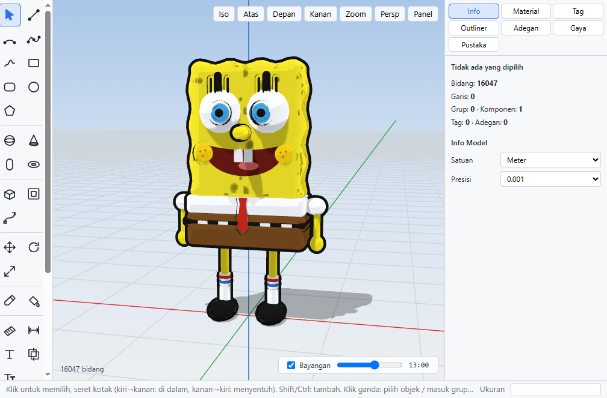

# SketchClone

Aplikasi desktop pemodelan 3D untuk Windows, terinspirasi SketchUp. Dibuat dengan Electron + Three.js.



## Unduh

Ambil installer terbaru di halaman **[Releases](https://github.com/firestarr/sketchclone/releases/latest)**:

- `SketchClone-Setup-x.y.z.exe` — installer (disarankan; aplikasi akan **memperbarui dirinya sendiri** setiap ada versi baru)
- `SketchClone-x.y.z.exe` — versi portable (tanpa instalasi, tanpa pembaruan otomatis)

Installer belum ditandatangani digital, jadi Windows SmartScreen bisa menampilkan peringatan: klik **More info → Run anyway**.

## Fitur

**Menggambar & mengubah** — Garis, Busur, Kurva halus, Gambar bebas, Persegi (biasa & sudut bulat), Lingkaran, Poligon, Dinding dari denah, Bola, Kerucut, Kapsul, Torus, Dorong/Tarik, Offset, Follow Me, Pindah (regangkan titik/tepi/bidang; Ctrl = salin; ketik `5x` / `/5` untuk larik), Putar, Skala (pegangan di layar, per sumbu, cermin), Penghapus, Cat.

**Bentuk lanjutan** — Bulatkan sudut / semua rusuk, Chamfer, Haluskan permukaan (subdivisi), Lentur / Runcing / Puntir, Pahat (Smoove), Potong bersilangan (Intersect), Solid Tools (gabung, kurangi, irisan), Atap pelana otomatis, Teks 3D, Medan (Sandbox).

**Konstruksi bangunan** — Kusen pintu & jendela yang otomatis melubangi dinding (ikut bergerak bersama dindingnya), alat Ruang (nama + luas m² tampil di model dan denah), lantai bertingkat (elevasi, tampil/sembunyi per lantai), tangga beton + reling antar-lantai bentuk lurus / L / U dengan bordes (lantai atas otomatis berlubang), utilitas listrik & sanitasi (lampu, saklar, stop kontak, AC, exhaust, panel, kloset, wastafel, bak mandi, kran, floor drain, septic tank, tandon, pompa) lengkap dengan simbol di denah dan perkiraan panjang kabel & pipa, denah per lantai di PDF (lengkap dengan busur bukaan pintu), dan **RAB otomatis** dari model: galian, pondasi, sloof, kolom praktis, ring balok, pasangan bata (dikurangi bukaan), plester, acian, cat, keramik, plafon, kusen, daun pintu/jendela, cor dak, rangka & genteng atap, beton & reling tangga, titik listrik, sanitari, kabel & pipa — ukuran pondasi dan harga AHSP bisa diubah, rekapitulasi + jasa kontraktor + PPN + terbilang, kebutuhan bahan pokok (semen, pasir, kerikil, bata, besi, keramik, cat — koefisien SNI, harga material RAB_Bangunan), jadwal & Kurva S, ekspor Excel format RAB_Bangunan dan **Laporan RAB PDF** siap cetak (panel kanan → **Konstruksi**, atau Berkas → RAB Otomatis).

**Rumah siap pakai & dokumen proyek** — Template Rumah Tipe 36, 45, 54, dan 2 Lantai (lengkap dengan kusen, ruang, utilitas, atap, struktur, dan RAB). Struktur otomatis: kolom praktis (digeser dari kusen), ring balok, sloof, pondasi batu kali, dengan **daftar pembesian** per diameter (batang 12 m). Gambar kerja PDF: denah per lantai (kolom, kode kusen + tabel kusen, dimensi tiap dinding, garis potong A-A / B-B), **tampak 4 sisi** dan **potongan A-A / B-B** dengan level ±0,00.

**Renovasi, cek struktur & proposal** — *Mode renovasi*: tandai bagian bangunan sebagai **Eksisting**, **Dibongkar**, atau **Baru** (sekali klik "Semua yang ada = Eksisting"); tampilan warna fase / kondisi lama / rencana; RAB hanya menghitung pekerjaan baru + bongkaran (bongkar dinding, atap, plafon, kusen, beton, angkut puing, bobok dinding lama untuk pintu/jendela baru); denah memakai warna standar (abu-abu eksisting, merah putus-putus dibongkar, hitam baru). *Elemen beton*: plat, balok, kolom struktur + footplat dengan beton, bekisting, dan besi masuk RAB & daftar pembesian. *Cek struktur*: tebal plat (bentang & tumpuan), plat menggantung, ukuran balok, beban kolom (luas pengaruh, 1,2D + 1,6L), kolom praktis yang memikul plat, ring balok, footplat & pondasi batu kali, serta **batas tanah** (isi ukuran kavling: pondasi & footplat di tepi otomatis dibuat *pinggir* tanpa menyeberang batas, sloof pengikat untuk footplat pinggir, dan peringatan bila ada bagian bangunan keluar batas) — lengkap dengan saran ukuran dan tombol perbaikan otomatis (aturan praktis SNI 2847/1727; bukan pengganti insinyur sipil). *Proposal klien*: satu PDF dengan kop & logo perusahaan, gambar 3D, surat penawaran + terbilang, perbandingan paket **Hemat / Standar / Premium**, denah & tampak, RAB, jadwal & Kurva S, termin pembayaran, syarat, dan kolom tanda tangan.

**Produksi (panel kanan → Produksi)** — *Mebel*: kabinet/lemari parametrik, daftar potong otomatis dari papan di model, optimasi tata letak di lembar 2440×1220 (celah gergaji, arah serat), jumlah lembar & biaya, perlengkapan (engsel, handle, sekrup), laporan PDF, Excel, dan DXF untuk CNC. *Cetak 3D*: cek siap cetak (celah, normal terbalik, terlalu tipis, melebihi area cetak), berat filamen, lama & biaya cetak, ekspor STL/3MF dalam mm dengan skala. *Pola datar*: buka benda jadi jaring-jaring dengan garis potong, garis lipat, dan lidah lem — ekspor PDF ukuran asli, SVG untuk laser, atau DXF; plus pembuat kotak kemasan.

**Pengorganisasian** — Grup & Komponen bertaut (bisa bersarang), Salinan cermin bertaut, Tag, Outliner, Adegan + animasi, Sembunyikan/tampilkan, Bidang potong.

**Tampilan & render** — Gaya (Standar, Sketsa, Arsitek, Monokrom, Kawat, X-Ray, Kartun, Render), bayangan matahari dengan slider jam, bayangan lembut (AO), langit realistis, lampu & mode malam, material bertekstur / mengkilap / logam / kaca, posisi tekstur.

**Dokumen & berkas** — Gambar kerja PDF (tampak + dimensi + kop), daftar bahan Excel, **buka berkas SketchUp (.skp 2021+)** lengkap dengan grup & tag, ekspor kembali ke SketchUp (.dae), ekspor DXF / OBJ / STL / glTF / PNG / video, impor OBJ / STL, gambar referensi, simpan otomatis + pemulihan, riwayat versi, template.

**AI & berbagi** — Asisten AI (buat model dari teks atau gambar, memakai Claude API dengan kunci Anda sendiri), halaman web 3D interaktif dengan AR, lihat di HP lewat Wi-Fi (kode QR), pustaka komponen online, plugin JavaScript + konsol skrip.

Tekan **F1** di aplikasi untuk daftar pintasan keyboard.

## Figur Warga Nusantara

Panel **Pustaka** juga berisi 20 figur orang berpakaian khas Indonesia (14 dewasa + 6 anak): batik, lurik, kebaya, sarung, jarik, peci, blangkon, udeng, kerudung, caping, selendang songket, dan seragam SD merah-putih. Pakai untuk mengisi gambar kerja dan render; dari skrip: `sketch.library('warga_joko', x, y)`.

## Pustaka komponen online

Komponen di folder [`library/`](library) bisa dijelajahi dan ditempatkan langsung dari aplikasi (panel kanan → **Pustaka** → **Muat pustaka online**).

Untuk menambahkan komponen: pilih benda di aplikasi → **Bagikan ke pustaka online** → seret berkas `.skc` yang tersimpan ke halaman GitHub yang terbuka → **Commit changes** (atau ajukan *pull request*).

## Plugin

Taruh berkas `.js` di folder plugin (menu **Ekstensi → Buka Folder Plugin**):

```js
sketch.addCommand('Kotak 1 m', () => sketch.box(0, 0, 0, 1, 1, 1, '#d9b27c'));
```

API `sketch` juga dipakai Asisten AI: `box`, `roundBox`, `cylinder`, `sphere`, `ellipsoid`, `cone`, `capsule`, `torus`, `face`, `pushPull`, `wall`, `roof`, `library`, `door`, `window`, `wallFaceAt`, `room`, `level`, `stairs`, `mep`, `site`, `pondasi`, `rab`, `paint`, `finish`, `move`, `rotate`, `scaleIds`, `subtract`, `union`, `roundEdges`, `smooth`, `group`, `light`, `style`, `text`, `log`, `toast`, `addCommand`.

## Mengembangkan

```bash
npm install
npm start            # jalankan dari kode sumber
npm run dist         # buat installer di dist/
npm run release          # buat installer & unggah ke draf GitHub Release (butuh GH_TOKEN)
npm run release:publish  # terbitkan draf -> aplikasi terpasang akan memperbarui diri
node test/csg.test.js   # tes geometri (juga: groups, shapes, deform, arch, boolean2, boolean3, construct, production)
```

## Contoh hasil

- [Perbandingan SpongeBob dengan gambar referensi](docs/spongebob-perbandingan.png)
- [Contoh gambar kerja PDF](docs/contoh-gambar-kerja.pdf)
